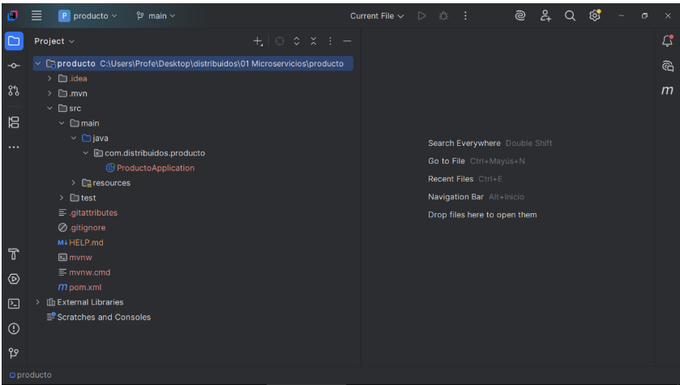
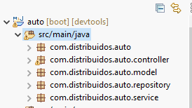
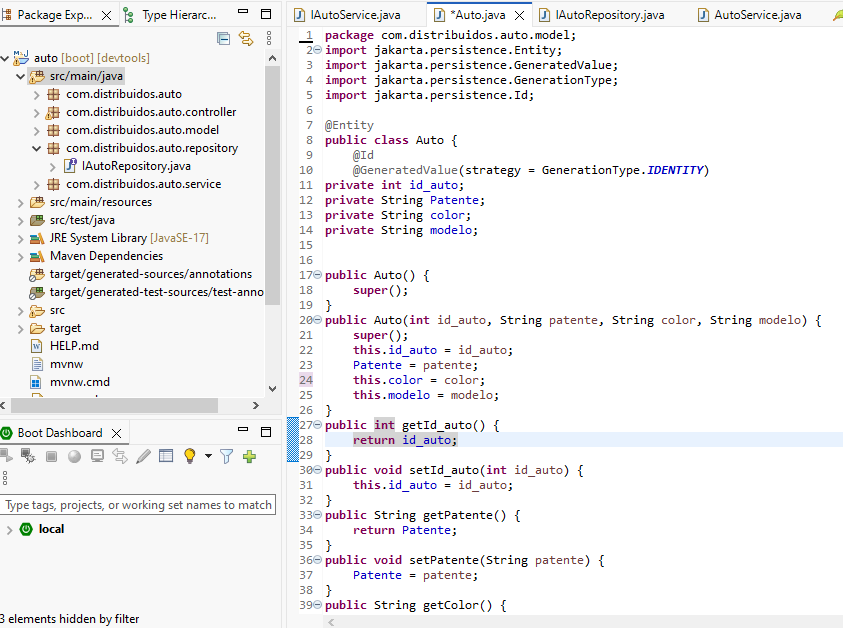
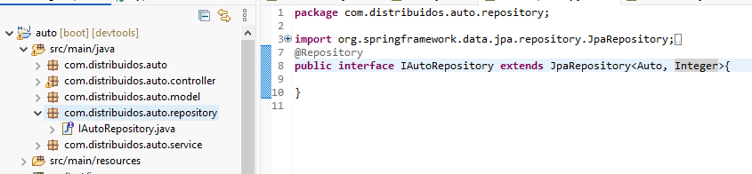
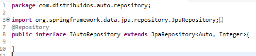
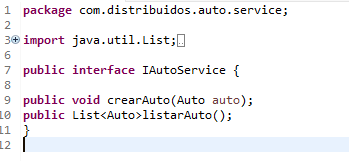
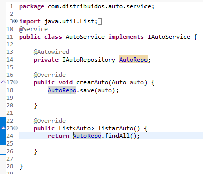
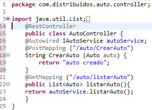
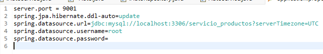
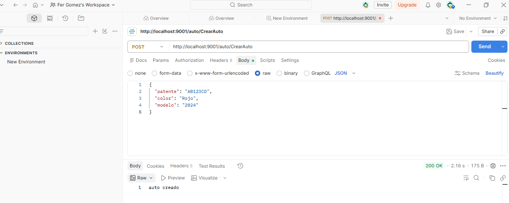

# Guía Paso a Paso: Creación de un Microservicio Base en Spring Boot
Esta guía servirá de base para el desarrollo del Trabajo Práctico Nro. 1 de la materia y tiene como objetivo brindar los lineamientos necesarios para la construcción de un microservicio básico en Spring Boot. El contenido presentado en este documento contempla la primera etapa del proyecto; la completitud del archivo README.md junto con el código correspondiente deberá ser finalizada y entregada a través del repositorio asignado con fecha límite el 2 de Octubre de 2026. En el ejemplo se trabaja con el IDE IntelliJ IDEA Community, pero el proyecto funcionará también en cualquier otro IDE compatible.

# 1. Configuración del Proyecto en Spring Initializr
Para dar inicio al desarrollo, ingrese al sitio web start.spring.io y configure los datos del formulario de la siguiente manera:

**Project:** Maven

**Language:** Java

**Spring Boot:** Seleccionar una versión estable 4.1.1 (o superior de acuerdo a la fecha de lectura de esta guía)

**Group:** com.distribuido

**Artifact:** producto

**Packaging:** Jar

**Java:** 17 (o la versión correspondiente al entorno de trabajo configurado)



### Dependencias requeridas: 
En el panel lateral derecho, proceda a seleccionar las siguientes 5 dependencias:   
+ Spring Boot DevTools: Proporciona reinicios automáticos de la aplicación y recarga en vivo para acelerar el proceso de desarrollo.   
+ Spring Web: Permite la construcción de aplicaciones web y la exposición de servicios RESTful utilizando Spring MVC.   
+ Spring Data JPA: Facilita la persistencia de datos en bases de datos relacionales mediante la API de Java Persistence y Hibernate.   
+ MySQL Driver: Controlador JDBC indispensable para conectar la aplicación con el motor de base de datos MySQL.   
+ Lombok: Librería de herramientas para desarrolladores que ayuda a reducir el código repetitivo (boilerplate code), generando automáticamente getters, setters, constructores y más mediante anotaciones.   

Posteriormente, haga clic en GENERATE, descargue el archivo comprimido .zip y proceda a descomprimirlo en su equipo.

# 2. Importación y Apertura en IntelliJ IDEA
Inicie la aplicación IntelliJ IDEA, NetBeans o la que usted utilice para trabajar.

Seleccione la opción File > Open... y navegue hasta el directorio donde descomprimió el proyecto (producto).

Aguarde unos momentos mientras el gestor de dependencias Maven efectúa la descarga e indexación del proyecto.

Verifique que la estructura del directorio mantenga la siguiente forma:

``` Plaintext
src/
└── main/
    └── java/
        └── com/
            └── distribuido/
                └── producto/
                    └── ProductoApplication.java
```


# 3. Creación de la Estructura de Paquetes
Con la finalidad de respetar estrictamente la arquitectura en capas (Controller → Service → Repository → DB), es necesario crear 4 paquetes dentro de la ruta principal com.distribuido.producto:

Haga clic derecho sobre el paquete base ***com.distribuido.producto***.

Diríjase a ***New > Package***.

Incorpore cada uno de los siguientes paquetes:

+ com.distribuido.producto.controller

+ com.distribuido.producto.model

+ com.distribuido.producto.repository

+ com.distribuido.producto.service

La jerarquía dentro del proyecto deberá visualizarse de la siguiente manera:

```Plaintext
com.distribuido.producto/
├── controller/
├── model/
├── repository/
├── service/
└── ProductoApplication.java
```



# 4. Creación de la Entidad Producto.java
Vamos a empezar con el modelado de **Producto**, la clase Producto.java debe estar en el paquete Model.
Dentro del paquete model, se procederá a definir la clase de dominio que representará la tabla dentro de la base de datos. En este caso dado que se trata del primer microservicio que estamos haciendo utilizaremos únicamente tipos de datos elementales para facilitar la comprensión.

Seleccione ***New > Java Class*** e ingrese el nombre **Producto**.




```java
package com.distribuidos.auto.model;
import jakarta.persistence.Entity;
import jakarta.persistence.GeneratedValue;
import jakarta.persistence.GenerationType;
import jakarta.persistence.Id;

@Entity
public class Auto {
	@Id
	@GeneratedValue(strategy = GenerationType.IDENTITY)
private int id_auto;
private String Patente;
private String color;
private String modelo;


public Auto() {
	super();
}
public Auto(int id_auto, String patente, String color, String modelo) {
	super();
	this.id_auto = id_auto;
	Patente = patente;
	this.color = color; 
	this.modelo = modelo;
}
public int getId_auto() {
	return id_auto;
}
public void setId_auto(int id_auto) {
	this.id_auto = id_auto;
}
public String getPatente() {
	return Patente;
}
public void setPatente(String patente) {
	Patente = patente;
}
public String getColor() {
	return color;
}
public void setColor(String color) {
	this.color = color;
}
public String getModelo() {
	return modelo;
}
public void setModelo(String modelo) {
	this.modelo = modelo;
}

}
```
# 5. Creación de Interface de Repository
Se debe crear la interfaz de repositori dentro del paquete repository, la interfaz la creamos para poder heredar los metodos que tiene JPARepository

Seleccione ***New > Java Interface*** e ingrese el nombre **IAutoRepository**.




```java
package com.distribuidos.auto.repository;

import org.springframework.data.jpa.repository.JpaRepository;
import org.springframework.stereotype.Repository;

import com.distribuidos.auto.model.Auto;
@Repository
public interface IAutoRepository extends JpaRepository<Auto, Integer>{

}
```
# 6. Creación de Interface de Service
Para crear la interfaz de service nos pocisionamos dentro del paquete **IAutoService**, en la interfaz haremos la firma de los metodos.

Seleccione ***New > Java Interface*** e ingrese el nombre **IAutoService**.


```java
package com.distribuidos.auto.service;

import java.util.List;

import com.distribuidos.auto.model.Auto;

public interface IAutoService {
	
public void crearAuto(Auto auto);
public List<Auto>listarAuto();
}
```
# 7. Implementación de Interface de Service
Para hacer la implementacion de la interfaz service crearemos una clase dentro del paquete **Service** que se llamara **AutoService**. Aca implementaremos los metodos que creamos en la interfaz **IautoService** y haremos una inyecciones de depencia del repository para poder utilizar tambien sus metodos.

Seleccione ***New > Java class*** e ingrese el nombre **AutoService**.

```java
package com.distribuidos.auto.service;

import java.util.List;

import org.springframework.beans.factory.annotation.Autowired;
import org.springframework.stereotype.Service;

import com.distribuidos.auto.model.Auto;
import com.distribuidos.auto.repository.IAutoRepository;
@Service
public class AutoService implements IAutoService {
	
	@Autowired
	private IAutoRepository AutoRepo;
	
	@Override
	public void crearAuto(Auto auto) {
		AutoRepo.save(auto);
		
	}

	@Override
	public List<Auto> listarAuto() {
		return AutoRepo.findAll();
		
	}

}
```


# 8. Creación de Controller(endpoints)
Dentro del paquete controller, procederemos a crear la clase que se llamara **AutoController** que se encargará de gestionar los endpoints o rutas de nuestra aplicación, permitiendo la comunicación entre el cliente y nuestra lógica.

Seleccione ***New > Java class*** e ingrese el nombre **AutoController**.
Aqui tendremos los:@PostMapping("/auto/CrearAuto"): Define un endpoint de tipo POST que nos permite recibir la información necesaria para registrar o crear un nuevo auto.   @GetMapping("/auto/listarAuto"): Define un endpoint de tipo GET que invoca el método listarAuto() del servicio para obtener y retornar la lista completa de autos registrados. 


```java
package com.distribuidos.auto.controller;

import java.util.List;

import org.springframework.beans.factory.annotation.Autowired;
import org.springframework.web.bind.annotation.GetMapping;
import org.springframework.web.bind.annotation.PostMapping;
import org.springframework.web.bind.annotation.RestController;

import com.distribuidos.auto.model.Auto;
import com.distribuidos.auto.service.IAutoService;

import jakarta.annotation.Generated;
	@RestController
	public class AutoController {
	@Autowired IAutoService autoService;
	@PostMapping ("/auto/CrearAuto")
	String CrearAuto (Auto auto) {
		return "auto creado";
	}
	@GetMapping ("/auto/listarAuto")
	public List<Auto> listarAuto(){
	return autoService.listarAuto();
	}
}
```


# 9. Configuración de properties y XAMMP
Para que el microservicio logre conectarse a la base de datos y ejecutarse en el puerto especificado, debe ingresar al archivo ubicado en la siguiente ruta. Recordar tener instalado y corriendo xampp:
```plaintext
src/main/resources/application.properties
```
Dentro de dicho archivo, incorpore las siguientes líneas de configuración:

```plaintext
server.port = 9001
spring.jpa.hibernate.ddl-auto=update
spring.datasource.url=jdbc:mysql://localhost:3306/servicio_productos?serverTimezone=UTC
spring.datasource.username=root
spring.datasource.password=
```






# Consigna del Trabajo Práctico
Fecha límite de entrega: 2 de Octubre de 2026

**Consigna:**
Basándose en la explicación brindada en clase para las capas restantes y en la demostración práctica del profesor, complete este archivo README.md documentando de forma detallada:

+ La creación e implementación de la interfaz ProductoRepository dentro del paquete repository.

+ La creación e implementación de la clase ProductoService dentro del paquete service.

+ La creación e implementación de la clase ProductoController dentro del paquete controller.

+ La configuración del archivo application.properties para entablar la conexión con la base de datos MySQL.

+ Las instrucciones paso a paso para ejecutar la aplicación y verificar el funcionamiento de los endpoints utilizando Postman, Bruno o el navegador.

## Recursos de Apoyo para la Realización de la Guía
Para orientar el desarrollo correcto de la arquitectura y la configuración del entorno, considere los siguientes aspectos técnicos fundamentales:

Regla de Comunicación Estricta entre Capas
Al momento de diseñar e implementar el código de las capas faltantes, respete la jerarquía de llamadas del patrón arquitectónico:

```Plaintext
[ Controller ] -> [ Service ] -> [ Repository ] -> [ DataBase ]

El Controller llama al Service: Gestiona la petición HTTP y delega la ejecución de la lógica al servicio.

El Service llama al Repository: Procesa las reglas de negocio y solicita las operaciones de datos al repositorio.

El Repository llama a la DataBase: Ejecuta las consultas y la persistencia directa en el motor relacional.
```
### Configuración del Archivo application.properties
Para que el microservicio logre conectarse a la base de datos y ejecutarse en el puerto especificado, debe ingresar al archivo ubicado en la siguiente ruta. Recordar tener instalado y corriendo xampp:
```plaintext
src/main/resources/application.properties
```
Dentro de dicho archivo, incorpore las siguientes líneas de configuración:

```plaintext
server.port = 9001
spring.jpa.hibernate.ddl-auto=update
spring.datasource.url=jdbc:mysql://localhost:3306/servicio_productos?serverTimezone=UTC
spring.datasource.username=root
spring.datasource.password=
```